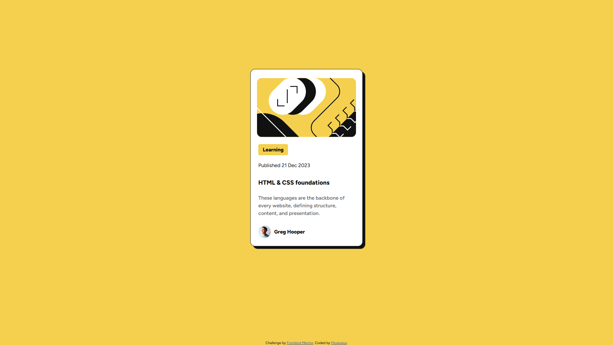

# Frontend Mentor - Blog preview card solution

This is a solution to the [Blog preview card challenge on Frontend Mentor](https://www.frontendmentor.io/challenges/blog-preview-card-ckPaj01IcS). Frontend Mentor challenges help you improve your coding skills by building realistic projects. 

## Table of contents

- [Overview](#overview)
  - [The challenge](#the-challenge)
  - [Screenshot](#screenshot)
  - [Links](#links)
- [My process](#my-process)
  - [Built with](#built-with)
  - [What I learned](#what-i-learned)
  - [Continued development](#continued-development)
  - [Useful resources](#useful-resources)
- [Author](#author)

## Overview

This challenge is an "upgrade" over the QR Code challenge, in the sense that it involves adding a couple interactive elements, and decorations.
I personally saw it as an opportunity to experiment a little with things, and to play around with "responsive" units: vh, vw, em, rem, etc.,
which has helped me understand how they work and how they differ from each other. Took me like three hours to finish this challenge but that's
because I honestly was having fun combing through the MDN CSS reference and trying new things. I also decided to take my timea little polishing
my CSS before deciding I was done.

### The challenge

Users should be able to:

- See hover and focus states for all interactive elements on the page

### Screenshot

### Links

- Solution URL: [Blog Preview Github page](https://filiuslupus.github.io/HTML-Practice/Blog-preview-practice/index.html)

## My process

I started as I like to start these kinds of things: First I adjusted the HTML structure so it fit the approach I had in mind for the CSS.
ABout the only thing I think could be considered "extra" was adding a datetime tag to the date, which is an attribute I remember having
seen before, but completely forgot about until yesterday when I was looking up <link> tag attributes. After that was done I jumped into
the CSS, which were I spent for all intents and purposes the entirety of the challenge tinkering and trying some things out.

Setting up the hover elements was not honestly that hard for me, due to my informal experience poking CSS in other webpages. However, what
did take me time to figure out was what properties to use and how to use them in such a way that the dimensions stayed consistent when
shrinking the width or height of the viewport. Among those, the ones that I spent the most experimenting and tinkering with were how and when
to use em, rem, vh, and vw.

Something that kept bugging me throught the entire development process was that the font did not look "right" to me, as if almost was missing. 
After about 40 minutes of proverbially banging my head against the desk and scouring MDN's CSS reference, it turns out that the reason for that
was that I was not actually invoking the Figtree font, because I had not included a @font-face declaration. Oh well, at least now I know.

### Built with

-- Semantic HTML5 markup
- CSS custom properties
- Flexbox
- Visual Studio Code
- htmlcheatsheet.com/css/
- MDN CSS documentation

### What I learned

- Import your font-faces people. This is the basics of the CSS declaration:

@font-face {
    font-family: "_fontname_";
    src: url("_yoururl_");
    format: "truetype";
    font-display: swap;
}

- Use vh and vw units to make elements stay proportional to the viewport.
- Use rem or em to make elements stay proportional to other elements
- When using the transition property, you should specify which properties it applies
to (kind of a no-brainer in hindsight)

### Continued development

- Expanding my knowledge of CSS layout techniques, which of course includes Flexbox and Grid.
- Expanding my understanding of the cascade

### Useful resources

- [Mozilla's CSS reference](https://developer.mozilla.org/en-US/docs/Web/CSS) - Coming in clutch just like the previous exercise. It is comically
easy to get lost in the (CSS) sauce. 
- [HTML Cheat Sheet](https://htmlcheatsheet.com/css/) - A "shorthand" way for me to recall concepts that I know what they do when looking at them
but forget the name (e.g. selectors, appropiate syntexis to include an external CSS file, etc.)

## Author

- Github - [filiuslupus](https://www.github.com/filiuslupus)
- Frontend Mentor - [@filiuslupus](https://www.frontendmentor.io/profile/filiuslupus)
