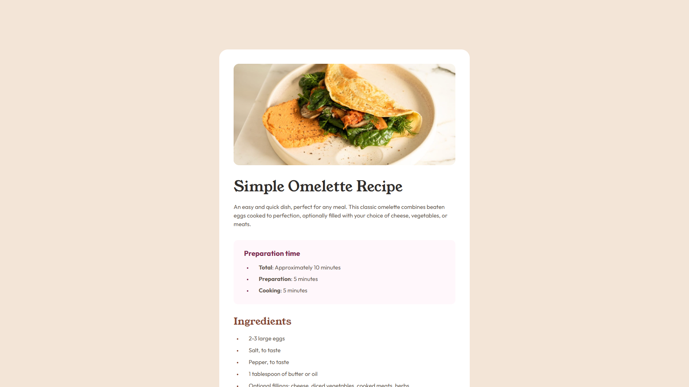

# Frontend Mentor - Recipe page solution

This is a solution to the [Recipe page challenge on Frontend Mentor](https://www.frontendmentor.io/challenges/recipe-page-KiTsR8QQKm). Frontend Mentor challenges help you improve your coding skills by building realistic projects. 

## Table of contents

- [Overview](#overview)
  - [Screenshot](#screenshot)
  - [Links](#links)
- [My process](#my-process)
  - [Built with](#built-with)
  - [What I learned](#what-i-learned)
  - [Continued development](#continued-development)
  - [Useful resources](#useful-resources)
  - [AI Collaboration](#ai-collaboration)
- [Author](#author)

## Overview

This challenge expands on previous concepts by adding a layer complexity with tables, lists, and responsive design,
in the form of a webpage for a recipe. I would say the most difficult part of this challenge is having to create
separate rule sets for lists to accomodate for spacing, color, etc., and styling the table. Curiously enough styling
the mobile view was not that hard, but I did end up using Codex for some spacing problems I had with the table.
EVerything was handcrafted by yours truly.

### Screenshot

### Links

- Solution URL: [Recipe page](https://filiuslupus.github.io/HTML-Practice/recipe-page-main/index.html)

## My process

As always, I began with structuring the HTML in what I thought was the best way to do so. In this challenge however,
I left the table to quite literally last, and focused first on getting everything else in place and making it look
nice, with the appropiate spacing. I struggled a little in this part with the styles for the unordered lists, and also
with trying to find a way to apply certain styles to the subheaders without affecting the "Preparation time" header,
which led me to discover the "not" pseudoclass. Pretty handy to be honest.

I think this is the challenge in which I've had to go back and edit the HTML the most time so far. As I added a few

 tags for the section separator lines, and since this was my frist time structuring a table, I had to try a few
times until I got it right. When it came to styling the spacing, and adding the in-between lines however, I did decide
to brainstorm a little using Codex, since everything I had tried with spacing did not work. Specifically, I was
struggling with "What selector do I use to accomplish the look I want?", which was quickly solved after a quick back
and forth.

Honestly the table itself looked great without the spacing styling (width: 100% got it pretty close), but
I was taking quite seriously the "get it as close to the design as possible", so I ended up throwing a bunch of
margin and padding rules. Maybe not neccessary, but it's good practice. And in a curious reversal of last challenge's
smooth stop solution, the rule for adding in between lines to the table is just:

table tr:not(:last-child) > td {
    border-bottom: 1px solid #E3DDD7;
}

with a border-collapse rule in the table selector to clean up the table.

Last but not least was the @media at-rule I added to match the mobile design, which I fortunately have some experience
with due to my nosing around at my job. Setting up had a few "bro what" moments, but I managed to solve those quickly.

And that's that. Pretty entertaining all things considered. I honestly seriously considered subsituting the recipe
with my own at one point, but I think that would've been too much. Another time for that.

### Built with

- Semantic HTML5 markup
- CSS custom properties
- Flexbox
- @media responsive rules
- Table styling elements

### Tools Used

- Visual Studio Code
- htmlcheatsheet.com/css/
- OpenAI's Codex, model 6.1-Sol.

### What I learned

Pretty stoked about the not pseudoclass, and managing to not completely break the CSS of the first table I worked with.
Oh, and the 
 tag is also kinda neat for styling.

### Continued development

Tables. Definitely would like some more practice with styling tables.

### Useful resources

- [Mozilla's CSS reference](https://developer.mozilla.org/en-US/docs/Web/CSS) - To revisit and explore new concepts 
- [HTML Cheat Sheet](https://htmlcheatsheet.com/css/) - A "shorthand" way for me to recall concepts that I know what they
do when looking at them but forget the name (e.g. selectors, appropiate syntexis to include an external CSS file, etc.)

### AI Collaboration

Used OpenAI's Codex with the 6.1-Sol model for a better understanding of the way styling works with tables,
as I had some issues with the spacing that I quite couldn't figure out.

## Author

- Github - [filiuslupus](https://www.github.com/filiuslupus)
- Frontend Mentor - [@filiuslupus](https://www.frontendmentor.io/profile/filiuslupus)