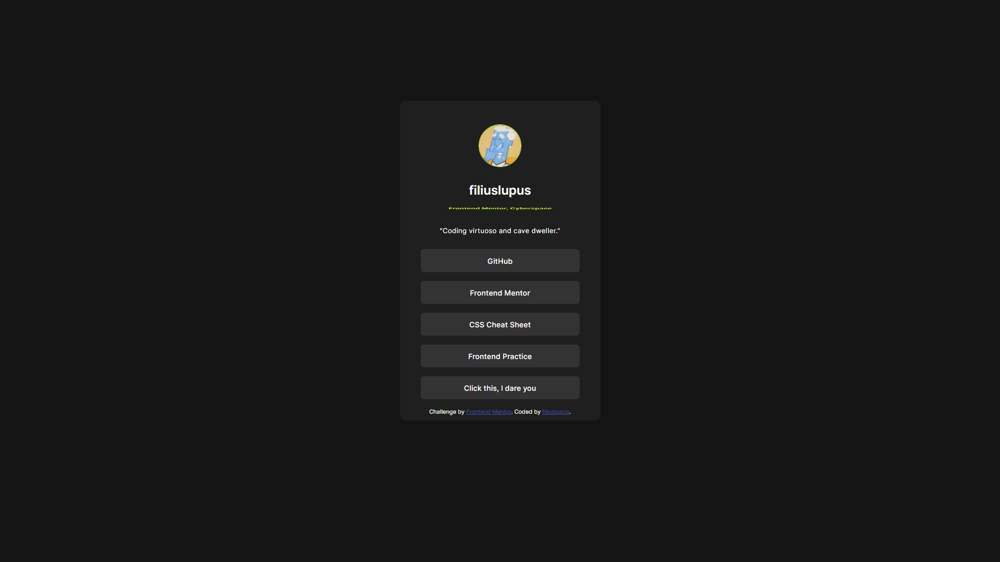

# Frontend Mentor - Social links profile solution

This is a solution to the [Social links profile challenge on Frontend Mentor](https://www.frontendmentor.io/challenges/social-links-profile-UG32l9m6dQ). Frontend Mentor challenges help you improve your coding skills by building realistic projects. 

## Table of contents

- [Overview](#overview)
  - [Screenshot](#screenshot)
  - [Links](#links)
- [My process](#my-process)
  - [Built with](#built-with)
  - [What I learned](#what-i-learned)
  - [Continued development](#continued-development)
  - [Useful resources](#useful-resources)
  - [AI Collaboration](#ai-collaboration)
- [Author](#author)

## Overview

Continuing the starting path challenges, this challenge in particular added a bit more complexity with hover effects.
I tried expanding a little on the concept of making the design "mine", and incorporated some minor tweaks as part of
me trying some new things: an outline to the profile image, a looping animation to the "location" part (with another
animation for a "smooth" reset when hovering over it), and an animation for the socials links hover. This challenge
also marks the first time I have incorporated AI assistance (I couldn't figure out how to implement a "stop" animation
for the spinning location; turns out is a tad more complex than I thought. The more you know)

### Screenshot

### Links

- Solution URL: [Social Links card Github page](https://filiuslupus.github.io/HTML-Practice/social-links-profile-main/index.html)

## My process

As before, I started setting up my html with tags and classes that I thought were best for both best atructuring practices,
and for CSS selectors, plus the requisite <link> for the stylsheet and font. Something new I learned is that the crossorigin
attribute is a must when preloading fonts, as leaving this attribute out means the browser downloads the font twice,
and can return some console warnings. I still don't understand the why's myself, but I do know that it is related to
CORS (something new to read up on later).

After that, it was the CSS document turn with the usual: Loading up the font, setting the colors, poisitioning, sizing
etc. Cross-referencing with the sample designs to make sure that the proportions looked right. Once I jumped to the
links hover effects, I realized it would be cleaner if I trimmed the HTML a little. I originally had set up the links
with a div for each one, such that every link looked like this in the HTML:

  <a class="socials-link" href="https://github.com/filiuslupus">GitHub</a>

But this meant that the links were unnecessarily nested, so I removed the divs and styled the anchors directly. Once the
anchors looked like the original design, I had the idea of having the hover fill the background left to right, as a personal
touch of sorts. A little googling and reference digging later, I managed to make it work (It was honestly easier than I
thought). And then I had the brilliant ide of making the location spin vertically

The spin effect itself was not that complicated. I had discovered the @keyframes at-rule previously when I was looking up the
@font-face at-rule, and decided to try it out. The animation is literally just three lines:

@keyframes spin {
  50% {rotate: x 180deg;}

And then you add to your selector something like this:

  animation: spin 5s infinite;

(Note: I had originally set the keyframe to 360deg, but I do not like the way the animation looks, alomst as if it "speeds up"
when it is turning, and slows down when it looks upright, something new to investigate in my spare time; 180deg has the exact
speed I was looking for.)

But then I had a thought: "What if someone wants to hover to stop the spin?" I had initially added a hover pseudo selector to
stop the animation, but no matter what I tried, the text just switched to immediately being upright, which looked ugly if you
ask me. I must have spent a good hour looking up ways to have a smooth animation "reset" before giving up. And for the first
time since I began these exercises, I decided to fire up Codex for help coming up with a solution for my nothing-burger problem.
After some back and forth later, including laying out all the solutions I had attempted, the first proposal was:

rotate: x 0deg !important (Ah, good ol' "!important", you love to see it.)

That obviosuly did not work; Codex even hit me with, and I quote "You applied my suggestion correctly—the problem is the approach
I recommended" (Bro what).

So back to the drawing board. After some more back and forth, the solution for the "smooth" stop I was looking for ended up being
made of the following:

@property --spin-angle {
    syntax: "<angle>";
    inherits: false;
    initial-value: 0deg;
    }
@property --spin-strength {
        syntax: "<number>";
        inherits: false;
        initial-value: 1;
    }

p.location {
  transition: --spin-strength .4s ease-out;
  rotate: x calc(var(--spin-angle) * var(--spin-strength));
}

.location:hover {
    animation-play-state: paused;
    --spin-strength: 0;
}

Just to emphasize it, the stop animation is 12 lines total; the spin animation is three. It was almost not worth, but oh well. You learn
something new that way.

### Built with

- Semantic HTML5 markup
- CSS custom properties
- Flexbox
- Visual Studio Code
- htmlcheatsheet.com/css/
- OpenAI's Codex, model 6.1-Sol.

### What I learned

- crossorigin is a must for preloading fonts
- The @property at-rule
- A few new transition tricks

### Continued development

I'd like to delve deeper in using @property at some point. Maybe not at the moment, as I hate it right now, but one day.

### Useful resources

- [Mozilla's CSS reference](https://developer.mozilla.org/en-US/docs/Web/CSS) - To revisit and explore new concepts 
- [HTML Cheat Sheet](https://htmlcheatsheet.com/css/) - A "shorthand" way for me to recall concepts that I know what they
do when looking at them but forget the name (e.g. selectors, appropiate syntexis to include an external CSS file, etc.)

### AI Collaboration

Used OpenAI's Codex with the 6.1-Sol model for quickly iterating a solution to the "smooth stop" rotating animation.
Took a few tries of back and forth iteration but 15 minutes later I had a working solution.

## Author

- Github - [filiuslupus](https://www.github.com/filiuslupus)
- Frontend Mentor - [@filiuslupus](https://www.frontendmentor.io/profile/filiuslupus)